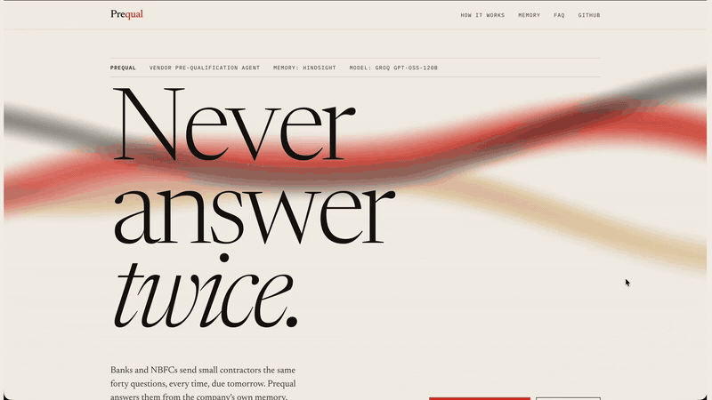

<p align="center">
  
</p>

# Prequal

Prequal fills in vendor pre-qualification questionnaires (PQs) for a small contractor, using the company's own memory stored in [Hindsight](https://github.com/vectorize-io/hindsight). Each answer shows the evidence it came from. If the company can't back something up, Prequal marks it as a gap instead of guessing.

[2-minute demo](https://youtu.be/cmx4w6JXkEw) · [Write-up](https://dev.to/victorisaacchintaeng/my-agent-kept-forgetting-our-company-so-i-gave-it-hindsight-37p3)

Small contractors get these questionnaires from banks, NBFCs, insurers and hospital chains: 30 to 60 questions plus a folder of supporting documents, usually due in days. The answers are mostly the same as last time, but last time lives in someone's email. So the questionnaire takes days, or never gets submitted, and the work is lost. We wanted the next one to start from everything the company has already said.

The seed company, Northstar Interiors, is fictional. Its identifiers and figures are synthetic, modelled on the structure of a real interior fit-out firm and the questionnaire formats it receives.

<p align="center">
  
</p>

## Memory first

<p align="center">
  
</p>

With an empty memory bank Prequal answers nothing and sends every question to review. Load the company into Hindsight and the same questionnaire comes back 38 of 43 answered, each with its source.

Those numbers (38 auto, 1 needs review, 4 gaps on the 43-question Prithvi Fincorp questionnaire) are from one run on 28 Sep 2026 with Hindsight Cloud and Groq `gpt-oss-120b`. All four gaps are documents the company does not hold. That questionnaire has 15 exact fields, 13 document checks and 15 questions that need judgment, so the model is called for about a third of it. Model runs are not deterministic, so treat this as one real run, not a benchmark.

## How it works

<p align="center">
  
</p>

Each question is classified first. GSTIN, PAN, address and entity type are plain lookups, and document requests are checked against the document inventory, so the model never sees those. Everything else recalls evidence from Hindsight and goes to Groq, where the model has to call `submit_answer` with the evidence IDs it used, or `flag_gap`. Guardrails then decide whether the draft is auto, needs review, or a gap. The review screen draws a line from each answer to the memories it cited.

When a reviewer approves or edits an answer, it is retained in memory along with the reviewer's reason, so the next client's similar question recalls the corrected answer first. Turnover is retained once per financial year with a date, so "last three years" comes back as a timeline, newest first.

### Certificates

<p align="center">
  
</p>

A made-up certification on a pre-qualification form is worse than no answer. Document questions are answered from the inventory without a model. If a free-text draft claims ISO 9001, an EHS policy, Udyam/MSME registration or a quality manual the company doesn't hold, it is pulled out of auto and sent to a human with the reason.

### What goes into Hindsight

Hindsight is the only store of company facts. SQLite holds questionnaires, answers and review state, nothing else.

- One memory bank per company (`HINDSIGHT_BANK_ID`), created with a mission and a conservative disposition (skepticism 4, literalism 4).
- Directives on the bank: don't state a certification or figure that is not in memory, report changed facts as a dated timeline, prefer reviewer corrections.
- `retain()` at ingest: company profile facts, one dated fact per financial year for turnover, one fact per document (on file or not held, tagged with the document key), and every past questionnaire answer (tagged `pq:<client>`).
- `recall()` per question, scoped by type and tag. Financial questions recall world facts tagged `financial` so the UI can build a timeline from `occurred_start`; document questions recall by the document's tag; everything else recalls world, experience and observation memories.
- `reflect()` for a short brief before answering: what the company should know about this client's questionnaire.
- Approvals and edits are retained with the question, the client and the reviewer's reason. A new year's turnover retained live shows up at the top of the timeline on the next run.

## Running it

```bash
git clone https://github.com/victorisaacchinta-eng/prequal.git
cd prequal
python -m venv .venv && source .venv/bin/activate
pip install -r requirements.txt
cp .env.example .env        # add HINDSIGHT_API_KEY and GROQ_API_KEY
python scripts/hindsight_smoke.py && python scripts/groq_smoke.py
uvicorn backend.main:app --port 8000 --no-access-log
```

The landing page is at http://localhost:8000 and the review screen at http://localhost:8000/app.

Without keys you can run `PREQUAL_MOCK=1 uvicorn backend.main:app --port 8000`. The mock memory is an IDF-weighted keyword matcher and the mock drafter pastes the top evidence. It is there for UI work and as a demo fallback, not as a benchmark.

| Variable | Default | What it does |
|---|---|---|
| `HINDSIGHT_API_KEY` | | Hindsight Cloud key |
| `HINDSIGHT_BASE_URL` | `https://api.hindsight.vectorize.io` | Hindsight endpoint |
| `HINDSIGHT_BANK_ID` | `northstar-interiors` | One bank per company |
| `GROQ_API_KEY` | | Groq key |
| `GROQ_MODEL` | `openai/gpt-oss-120b` | Primary drafting model |
| `GROQ_FALLBACK_MODEL` | `openai/gpt-oss-20b` | Used after rate limits or server errors |
| `PREQUAL_MOCK` | `0` | `1` runs without keys |

To see the whole loop: click **Fresh agent** and **Run agent** on Prithvi Fincorp (everything goes to review), then **Ingest company memory** (profile, 17 documents and two past questionnaires) and run it again. Edit and approve an answer, then run Kestrel Bank and the similar question recalls it. Retaining the FY 2025-26 turnover and re-drafting the turnover question puts the new year at the top of the timeline.

## When things fail

- Tool arguments are validated with pydantic. Invalid arguments get one retry with the schema echoed back; a second failure becomes `needs review` with the raw text kept.
- A plain-text reply instead of a tool call is `needs review`, not an answer.
- Rate limits and server errors back off, then fall back to `gpt-oss-20b`. If both fail, `needs review` with "click Re-draft in a minute".
- Only the top 8 recalled memories go to the model (the timeline still uses all dated facts). This keeps prompts inside Groq's free-tier token limits.
- If Hindsight is unreachable during recall, the answer is `needs review`. If it is unreachable during retain, the memory is queued in SQLite and retried on `POST /api/memory/flush`.

## API

| Method and path | Purpose |
|---|---|
| `POST /api/ingest` | Retain seed data into the bank; build the deterministic caches |
| `POST /api/memory/reset` | Clear the bank (fresh agent) |
| `POST /api/memory/retain` | Retain one fact live |
| `POST /api/memory/flush` | Retry queued retains |
| `GET /api/memory/log` | Recent retain, recall and reflect calls |
| `POST /api/questionnaires/load-samples` | Load the three sample questionnaires |
| `POST /api/questionnaires` | Upload a questionnaire JSON |
| `POST /api/questionnaires/{id}/run` | Run the agent (server-sent events) |
| `POST /api/questionnaires/{id}/brief` | `reflect()` brief |
| `GET /api/questionnaires/{id}` | Questions, answers, evidence, statuses |
| `PATCH /api/answers/{id}` | approve, edit, gap, reopen |
| `GET /api/questionnaires/{id}/export?format=csv` | Final answers |

## Layout

```
backend/    main.py (FastAPI), memory.py (Hindsight + mock), agent.py (answer loop, guardrails),
            llm.py (Groq tool calling), db.py (SQLite), ingest.py (seed data)
frontend/   landing.html, index.html (review screen), app.js, styles.css, vendor/ (GSAP)
data/       company profile, document inventory, past answers, three questionnaires
scripts/    hindsight_smoke.py, groq_smoke.py
docs/       article.md, cover.png
```

## Not done yet

- Parse Excel and PDF questionnaires directly
- Write answers back into the client's own template
- Document expiry alerts, so a solvency certificate doesn't lapse without anyone noticing

## Credits

Built by Sunil Dehru, [Chintha Victor Isaac](https://github.com/victorisaacchinta-eng), Musukula Sri Charan Reddy, Jakula Hari Charan Reddy and Avinash. Memory by [Hindsight](https://github.com/vectorize-io/hindsight), drafting on [Groq](https://groq.com).

MIT licence, see [`LICENSE`](LICENSE).
